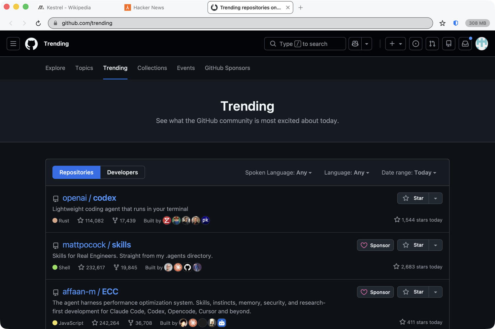

# Kestrel

A minimal macOS web browser. A single ~900 KB app bundle, no dependencies, no bundled
engine, no background services.

Built because Chrome ships its own entire copy of Chromium plus a GPU process, a
network service, extension hosts, an updater and telemetry daemons — on an 8 GB
machine that is most of your RAM before you open a tab. Kestrel renders with the
WebKit already resident in macOS and adds the two things Chrome will not do by
default.



## Kestrel vs Google Chrome, measured

> **Same five pages, same order, same machine.** Kestrel used **701 MB** where
> Chrome used **1.93 GB** — and once the background tabs went to sleep, **236 MB**
> against Chrome's **1.91 GB**. Chrome never gave the memory back.

| | Kestrel | Chrome 151 | |
|---|---|---|---|
| **Memory — 5 tabs loaded** | 701 MB | 1.93 GB | **2.8x less** |
| **Memory — same 5 tabs after idling** | 236 MB | 1.91 GB | **8.3x less** |
| Memory — idle, one empty tab | 28 MB | 403 MB | **14.2x less** |
| Processes for those 5 tabs | 8 | 47 | **5.9x fewer** |
| CPU while idling on those 5 tabs | 0.04% of a core | 0.11% of a core | **3.1x less** |
| Cold launch to a window on screen | 0.34 s | 0.41 s | **1.2x faster** |
| App on disk | 904 KB | 2.0 GB | **~2,400x smaller** |

Isolating the ad blocker, since that is the obvious objection — the same five pages in Kestrel with blocking **switched off**:

| | Memory, 5 tabs loaded |
|---|---|
| Kestrel, blocker on | 701 MB |
| Kestrel, blocker off | 822 MB |
| Chrome (no blocking, no extensions) | 1.93 GB |

So blocking accounts for part of it, but Kestrel with the blocker off still uses **2.4x less** memory than Chrome. The bulk of the win is architectural.

### How this was measured

Every number above comes from `./tools/bench.sh`, which you can run yourself. It
opens the **same five pages in the same order** in each browser
— Wikipedia, Hacker News, GitHub Trending, The Verge and CNN — waits for them to
settle, then reads `phys_footprint` and CPU time per process straight from the
kernel. That is the same figure Activity Monitor's Memory column shows, and helper
processes are attributed to their parent app exactly the way Activity Monitor does
it (`responsibility_get_pid_responsible_for_pid`). The table in this README is
generated from the raw measurement file by `tools/bench-table.py`, not typed by
hand.

Things that are deliberately **generous to Chrome**, so you can trust the gap:

- Chrome runs on a **throwaway `--user-data-dir`**, so it has **no extensions**
  loaded. A real Chrome with an ad blocker, a password manager and a long history is
  heavier than what is measured here. All browsing data for the run — history,
  cookies, cache — goes to that throwaway directory, not your real profile. (Chrome
  still writes some of its own machine-level metadata, such as crash and metrics
  caches, to the default location on any launch; that is Chrome's behaviour, not
  something the benchmark controls.) The script refuses to measure at all unless it
  can confirm Chrome is on the throwaway profile, and refuses to start if another
  Chrome is already running, so it can never fold your real session into the numbers.
- Chrome's **first-run launch is discarded** before timing, so startup is measured
  warm, not cold-from-install.
- The third table isolates ad blocking: Kestrel with its blocker **switched off**
  still uses far less memory, so the win is architectural, not just "it blocks ads".

And the honest caveats:

- **One machine, one run** (M1, 8 GB, macOS 26.5). Expect variance, especially on
  the ad-heavy pages, whose weight changes with whatever ads happen to be served.
- Chrome's high process count is partly **site isolation**, a real security feature
  that costs memory. Kestrel does not match it; WebKit isolates less aggressively.
- Chrome has a **Memory Saver** that discards inactive tabs, but it works on a much
  longer timescale than this test and did not trigger. Over hours, Chrome's idle
  number would improve.
- For a short test the sleep threshold was lowered to **1 minute**
  (`hibernateAfterMinutes`); the shipped default is 5.
- **CPU at rest is deliberately not reported.** Kestrel destroys tab processes during
  that window, and summing per-process CPU counters loses the time used by processes
  that no longer exist, so the figure would come out negative and meaningless.
- The blocker-off row is **memory only**. It was captured in the same session but
  before a fix to which tab gets focus, and focus materially changes CPU.
- Which tab is in the **foreground** matters more than you would guess: with an
  ad-heavy page focused instead of a static one, Kestrel's idle CPU measured 1.07%
  rather than 0.04%. Both browsers are given the same foreground page.
- Kestrel cannot win a like-for-like *rendering* benchmark — it is the same WebKit
  everyone else's Safari uses. The gains here are in what a browser wraps around an
  engine, not the engine.

## What actually makes it light

**1. No engine of its own.** Rendering is `WKWebView`, i.e. the same Safari engine
already loaded in the OS and shared with every other app. Kestrel's own UI process
measures ~30 MB. There is no updater, no telemetry, no extension host, no sync.

**2. Tabs that really sleep.** A background tab idle for 5 minutes has its WebKit
content process *destroyed*, not throttled. What survives is the URL, the title and
`interactionState` — a WebKit blob holding the full back/forward list and scroll
position, a couple of KB. Click the tab and it comes back where you left it. Chrome
and Safari only throttle timers; the ~50–300 MB per tab stays resident.

Sleeping also happens immediately when macOS reports memory pressure, so Kestrel
gives memory back to the system instead of competing for it.

**3. Ad and tracker blocking in the network layer.** 214 domain rules are compiled
once into a WebKit bytecode program that runs inside the networking process, so
blocked requests never reach the renderer at all. This is cheaper *and* stronger
than an extension: no JS, no per-request callback, nothing to run per page. Verified
with `tools/run-blocktest.sh`.

**4. A new tab costs nothing.** The new-tab page is drawn with AppKit, so an empty
tab allocates no web process. Restoring a session is lazy too — a 20-tab window
comes back with exactly one live renderer.

Autoplay is off, which removes most background CPU and video decode memory.

### Compare it against your own browser

```sh
./tools/kmem                 # Kestrel, Chrome and Safari side by side, right now
./tools/bench.sh             # the full comparison above, reproduced
```

Heavy sites cost what they cost — that is the page, not the browser. The win is
that you only pay for the tab you are actually looking at.

## Install

### Download the built app

Grab `Kestrel.zip` from [Releases](../../releases), unzip, and drag `Kestrel.app`
to `/Applications`.

Kestrel is ad-hoc signed and **not notarized by Apple**, so the first launch needs
one extra step — macOS quarantines anything downloaded from the internet:

```sh
xattr -dr com.apple.quarantine /Applications/Kestrel.app
open /Applications/Kestrel.app
```

(Or right-click the app → **Open** → **Open** in the dialog.) Without this you get
*"Kestrel is damaged"* or *"Apple could not verify..."* — that is Gatekeeper, not a
broken build. Notarizing would require a paid Apple Developer account.

### Or build it yourself

```sh
./build.sh /Applications      # compile, bundle, ad-hoc sign, install
open /Applications/Kestrel.app
```

Requires only the Xcode Command Line Tools. Build takes a few seconds, and a
locally built app needs no quarantine step.

To make it your default browser: **Kestrel → Make Kestrel the Default Browser**.

## Keyboard

| | |
|---|---|
| `⌘L` | address bar (history/bookmark autocomplete, no network suggestions) |
| `⌘T` / `⌘W` | new tab / close tab |
| `⌘⇧T` | reopen the tab you just closed |
| `⌘N` / `⌘⇧N` | new window / new private window |
| `^⇥` / `^⇧⇥` | next / previous tab (also `⌘⌥←` / `⌘⌥→`) |
| `⌘1`–`⌘9` | jump to tab |
| `⌘[` / `⌘]` | back / forward (or two-finger swipe) |
| `⌘R` / `⌘.` | reload / stop |
| `⌘F` / `⌘G` / `⌘⇧G` | find, find next, find previous |
| `⌘D` | bookmark |
| `⌘+` / `⌘-` / `⌘0` | zoom |
| `⌘⇧H` | put all background tabs to sleep now |
| `⌘⇧J` | open Downloads folder |
| `⌘,` | settings (opens config.json) |

**Mouse.** Middle-click or ⌘-click a link opens it in a background tab.
Middle-click a tab closes it. **Drag a tab** to reorder it. **Right-click a tab** for
reload, duplicate, copy address, put-to-sleep, close and close-others. Double-click
empty space in the tab strip for a new tab. Right-click a page → Inspect Element
opens Web Inspector.

Tabs shrink to fit however many you have open, so the last tab and the `+` button
stay reachable instead of sliding off the edge of the window.

Sleeping tabs are dimmed in the strip and say so in their tooltip, so a tab
reloading when you return to it is never a surprise. The pill on the right of the
toolbar is live total memory across every Kestrel process, plus how many tabs are
currently asleep — hover it for the per-process breakdown.

## Configuration

`~/Library/Application Support/Kestrel/config.json` — edited with `⌘,`, applied on
restart.

| key | default | |
|---|---|---|
| `searchTemplate` | Google | `%s` is the query; e.g. `https://duckduckgo.com/?q=%s` |
| `hibernateAfterMinutes` | `5` | `0` disables sleeping |
| `hibernateOnMemoryPressure` | `true` | sleep everything when macOS says it is low |
| `blockAdsAndTrackers` | `true` | also the shield button in the toolbar |
| `restoreSessionOnLaunch` | `true` | |
| `showMemoryReadout` | `true` | |
| `enableDeveloperTools` | `true` | |

Same folder holds `blocked-domains.txt` (one domain per line, `#` comments — add
your own and restart), `history.json`, `bookmarks.json` and `session.json`. All
plain files; nothing is a database.

## Layout

| | |
|---|---|
| `Sources/Tab.swift` | tab model, hibernate/wake, WebKit delegates |
| `Sources/BrowserWindowController.swift` | window chrome, tab switching, timers |
| `Sources/ContentBlocker.swift` | domain list → compiled WebKit rule list |
| `Sources/MemoryMonitor.swift` | per-process footprint, Activity-Monitor-style attribution |
| `Sources/TabStrip.swift` | hand-drawn tab strip, tab context menu |
| `Sources/Controls.swift` | toolbar buttons, address bar, status pill |
| `Sources/StartView.swift` | native new-tab page |
| `Sources/Store.swift` | history, bookmarks, session (flat JSON) |
| `tools/run-blocktest.sh` | functional test: are trackers actually blocked? |
| `tools/kmem` | footprint of Kestrel / Chrome / Safari, right now |
| `tools/bench.sh` | the full Chrome comparison, reproducible |
| `tools/bench-table.py` | turns raw results into the table above |
| `tools/waitwindow.swift` | cold-launch timing via the window server |

## Known limits

- **Not a new engine.** Site compatibility is Safari's. The rare site that only
  works in Chrome will not work here.
- **No extension support.** Ad blocking is built in; anything else is not available.
- **Multi-window sessions**: only the last window to close is restored.
- **Not notarized** (ad-hoc signed, built locally). Gatekeeper may ask on first
  launch; right-click → Open.
- Cosmetic ad rules are deliberately conservative, so some blocked slots leave a gap.

## License

MIT — see [LICENSE](LICENSE).
